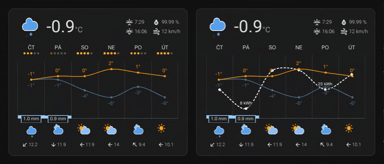
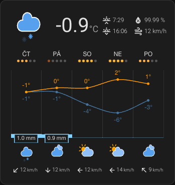
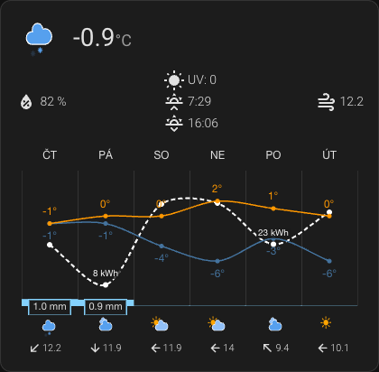

# Animated Solar Weather Chart Card

[](https://github.com/imatrixcz/animated-solar-weather-chart-card/releases/latest)
[](LICENSE.md)

[](https://my.home-assistant.io/redirect/hacs_repository/?owner=imatrixcz&repository=animated-solar-weather-chart-card&category=plugin)

An animated weather card with a forecast chart for Home Assistant – with an extra **daily solar forecast**.



This is a maintained fork of [mlamberts78/weather-chart-card](https://github.com/mlamberts78/weather-chart-card), which its author has deprecated. The original card works exactly as before; this fork adds two cards that show how much energy your solar panels are expected to produce each day.

| `weather-solar-dots-card` | `weather-solar-chart-card` |
| :---: | :---: |
|  |  |
| 1–5 dots under each day, click a day for the exact kWh | dashed white line with kWh in the chart |

## Cards in this package

All three cards are in one file (`weather-chart-card.js`), so one installation is enough.

| Card | What it shows |
| --- | --- |
| `custom:weather-chart-card` | The original weather card with chart. |
| `custom:weather-solar-dots-card` | Weather card + 1–5 dots per day by expected solar production. |
| `custom:weather-solar-chart-card` | Weather card + daily solar forecast drawn as a line in the chart. |

## Installation

### Home Assistant Marketplace (or HACS)

Click the button to open this repository in your Home Assistant, then press **Install**:

[](https://my.home-assistant.io/redirect/hacs_repository/?owner=imatrixcz&repository=animated-solar-weather-chart-card&category=plugin)

Or add it manually:

1. Open **Marketplace** (or HACS) → **Add from link** / **Custom repositories**.
2. Enter `https://github.com/imatrixcz/animated-solar-weather-chart-card` (type *Dashboard* / *Lovelace*).
3. Install **Animated Solar Weather Chart Card**. The dashboard resource is added automatically.

If you used the original `mlamberts78/weather-chart-card`, uninstall it first – this package already contains it.

### Manual

Copy `dist/weather-chart-card.js` (and the `icons`, `icons2` folders for animated icons) to `/config/www/weather-chart-card/` and add `/local/weather-chart-card/weather-chart-card.js` as a JavaScript module resource.

## Solar forecast

Both solar cards accept every option of `weather-chart-card` plus:

| Name | Type | Default | Description |
| --- | --- | --- | --- |
| `solar_entities` | list | **Required** | Sensors with the energy forecast for one day each, in **kWh**, with a `watts` attribute (timestamps of that day). Works with the [Open-Meteo Solar Forecast](https://github.com/rany2/ha-open-meteo-solar-forecast) and Forecast.Solar integrations (`sensor.energy_production_today`, `…_tomorrow`, `…_d2` … `…_d7`). |
| `solar_thresholds` | list | `[10, 20, 30, 50]` | *Dots card only.* kWh limits for 2, 3, 4 and 5 dots. 0 kWh = no dot, below the first limit = 1 dot. Tune them to your installation size. |

The day of each sensor is taken from its `watts` attribute, so sensors may be listed in any order and missing days are simply left empty.

### Example – dots

```yaml
type: custom:weather-solar-dots-card
entity: weather.forecast_home
animated_icons: true
icon_style: style2
forecast:
  style: style2
  round_temp: true
solar_thresholds: [10, 20, 30, 50]
solar_entities:
  - sensor.energy_production_today
  - sensor.energy_production_tomorrow
  - sensor.energy_production_d2
  - sensor.energy_production_d3
  - sensor.energy_production_d4
  - sensor.energy_production_d5
  - sensor.energy_production_d6
  - sensor.energy_production_d7
```

### Example – line

```yaml
type: custom:weather-solar-chart-card
entity: weather.forecast_home
solar_entities:
  - sensor.energy_production_today
  - sensor.energy_production_tomorrow
  - sensor.energy_production_d2
  - sensor.energy_production_d3
  - sensor.energy_production_d4
  - sensor.energy_production_d5
  - sensor.energy_production_d6
  - sensor.energy_production_d7
```

## Weather card options

These options work in all three cards.

### Card options

| Name                  | Type    | Default                  | Description                                                                                        |
| ----------------------| ------- | -------------------------|--------------------------------------------------------------------------------------------------- |
| type                  | string  | **Required**             | Should be `custom:weather-chart-card`.                                                             |
| entity                | string  | **Required**             | An entity_id with the `weather` domain.                                                            |
| temp                  | string  | none                     | An entity_id for a custom temperature sensor.                                                      |
| press                 | string  | none                     | An entity_id for a custom pressure sensor.                                                         |
| humid                 | string  | none                     | An entity_id for a custom humidity sensor.                                                         |
| uv                    | string  | none                     | An entity_id for a custom UV index sensor.                                                         |
| winddir               | string  | none                     | An entity_id for a custom wind bearing sensor. Sensor should have value in degrees                 |
| windspeed             | string  | none                     | An entity_id for a custom wind speed sensor.                                                       |
| feels_like            | string  | none                     | An entity_id for a custom feels like temperature sensor.                                           |
| dew_point             | string  | none                     | An entity_id for a custom dew point sensor.                                                        |
| wind_gust_speed       | string  | none                     | An entity_id for a custom wind gust speed sensor.                                                  |
| visibility            | string  | none                     | An entity_id for a custom visibility sensor.                                                       |
| description           | string  | none                     | An entity_id for a custom weather description sensor.                                              |
| title                 | string  | none                     | Card title.                                                                                        |
| show_main             | boolean | true                     | Show or hide a section with current weather condition and temperature.                             |
| show_temperature      | boolean | true                     | Show or hide the current temperature.                                                              |
| show_current_condition| boolean | true                     | Show or hide the current weather condition.                                                        |
| show_attributes       | boolean | true                     | Show or hide a section with attributes such as pressure, humidity, wind direction and speed, etc.  |
| show_sun              | boolean | true                     | Show or hide the sunset information                                                                |
| show_time             | boolean | false                    | Show or hide the current time on the card.                                                         |
| show_time_seconds     | boolean | false                    | Show or hide seconds for the current time on the card.                                             |
| show_day              | boolean | false                    | Show or hide the current day on the card. (Only visible when show_time is true.)                   |
| show_date             | boolean | false                    | Show or hide the current date the card. (Only visible when show_time is true.)                     |
| show_humidity         | boolean | true                     | Show or hide humidity on the card.                                                                 |
| show_pressure         | boolean | true                     | Show or hide pressure on the card.                                                                 |
| show_wind_direction   | boolean | true                     | Show or hide wind_direction on the card.                                                           |
| show_wind_speed       | boolean | true                     | Show or hide wind_speed on the card.                                                               |
| show_feels_like       | boolean | false                    | Show or hide feels like temperature on the card.                                                   |
| show_dew_point        | boolean | false                    | Show or hide dew point on the card.                                                                |
| show_wind_gust_speed  | boolean | false                    | Show or hide wind gust speed on the card.                                                          |
| show_visibility       | boolean | false                    | Show or hide visibility on the card.                                                               |
| show_description      | boolean | false                    | Show or hide the weather description on the card.                                                  |
| show_last_changed     | boolean | false                    | Show or hide when last data changed on the card.                                                   |
| use_12hour_format     | boolean | false                    | Display time in 12-hour format (AM/PM) instead of 24-hour format.                                  |
| icons                 | string  | none                     | Path to the location of custom icons in svg format, for example `/local/weather-icons/`.           |
| animated_icons        | boolean | false                    | Enable the use of animated icons                                                                   |
| icon_style            | string  | 'style1'                 | Options are 'style1' and'style2' for different set of animated icons.                              |
| icons_size            | number  | 25                       | The size of the animated or custom icons in pixels.                                                |
| current_temp_size     | number  | 28                       | The size of the current temperature in pixels.                                                     |
| time_size             | number  | 26                       | The size of the current time in pixels.                                                            |
| day_date_size         | number  | 15                       | The size of the current day and date in pixels.                                                    |
| forecast              | object  | none                     | See [forecast options](#forecast-options) for available options.                                   |
| units                 | object  | none                     | See [units of measurement](#units-of-measurement) for available options.                           |
| locale                | string  | none                     | See [Supported languages](#Supported-languages) for available languages                            |
| autoscroll            | boolean | false                    | Update the chart each hour, hiding prior forecast datapoints                                       |

### Forecast options

| Name                 | Type    | Default                  | Description                                                                                        |
| -------------------- | ------- | -------------------------|--------------------------------------------------------------------------------------------------- |
| precipitation_type   | string  | rainfall                 | Show precipitation in 'rainfall' or 'probability'.                                                 |
| show_probability     | boolean | false                    | Also show probability value when precipitation_type = rainfall. (Only when available)              |
| labels_font_size     | number  | 11                       | Font size for temperature and precipitation labels.                                                |
| precip_bar_size      | number  | 100                      | Adjusts the thickness of precipitation bars (1-100).                                               |
| temperature1_color   | string  | rgba(255, 152, 0, 1.0)   | Temperature first line chart color.                                                                |
| temperature2_color   | string  | rgba(68, 115, 158, 1.0)  | Temperature second line chart color.                                                               |
| precipitation_color  | string  | rgba(132, 209, 253, 1.0) | Precipitation bar chart color.                                                                     |
| chart_datetime_color | string  | primary-text-color       | Chart day or hour color                                                                            |
| chart_text_color     | string  | none                     | Chart text color                                                                                   |
| chart_height         | number  | 180                      | Adjust the forecast chart height                                                                   |
| condition_icons      | boolean | true                     | Show or hide forecast condition icons.                                                             |
| show_wind_forecast   | boolean | true                     | Show or hide wind forecast on the card.                                                            |
| round_temp           | boolean | false                    | Option for rounding the forecast temperatures                                                      |
| style                | string  | style1                   | Change chart style, options: 'style1' or 'style2'                                                  |
| type                 | string  | daily                    | Show daily or hourly forecast if available, options: 'daily' or 'hourly'                           |
| number_of_forecasts  | number  | 0                        | Overrides the number of forecasts to display. Set to "0" for automatic mode.                       |
| disable_animation    | boolean | false                    | Disable the chart animation.                                                                       |

### Units of measurement

| Name                 | Type    | Default                  | Description                                                                                        |
| -------------------- | ------- | -------------------------|--------------------------------------------------------------------------------------------------- |
| pressure             | string  | none                     | Convert to 'hPa' or 'mmHg' or 'inHg'                                                               |
| speed                | string  | none                     | Convert to 'km/h' or 'm/s' or 'Bft' or 'mph'                                                       |

### Custom icons

Icons must be SVG files named after the weather conditions listed in [`src/const.js`](src/const.js). Set `icons: /local/weather-icons/`.

### More examples

Chart only:

```yaml
type: custom:weather-chart-card
entity: weather.forecast_home
show_main: false
show_attributes: false
forecast:
  condition_icons: false
  show_wind_forecast: false
```

Hourly forecast with custom units:

```yaml
type: custom:weather-chart-card
entity: weather.forecast_home
forecast:
  type: hourly
units:
  pressure: hPa
  speed: m/s
```

### Supported languages
| Language         | Locale  |
| ---------------- | ------- |
| Bulgarian        | bg      |
| Catalan          | ca      |
| Czech            | cs      |
| Danish           | da      |
| Dutch            | nl      |
| English          | en      |
| Finnish          | fi      |
| French           | fr      |
| German           | de      |
| Greek            | el      |
| Hungarian        | hu      |
| Italian          | it      |
| Lithuanian       | lt      |
| Norwegian        | no      |
| Polish           | pl      |
| Portuguese       | pt      |
| Romanian         | ro      |
| Russian          | ru      |
| Slovak           | sk      |
| Spanish          | es      |
| Swedish          | sv      |
| Ukrainian        | uk      |
| 한국어           | ko      |

## Credits

Original card by [Marc Lamberts (mlamberts78)](https://github.com/mlamberts78/weather-chart-card), MIT license. Solar forecast cards and maintenance by [imatrixcz](https://github.com/imatrixcz).
